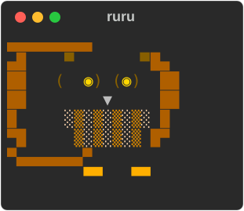

<p align="center"></p>

# ruru

A local, plain-text literature library with a feed inbox, a terminal UI and an agent-friendly CLI.

*Ruru* is the morepork, Aotearoa's native owl. The mascot above is drawn in `ruru/logo.py`
and shows up in the TUI and when you run `ruru` on its own.

Papers arrive from feeds (arXiv, OpenAlex, Crossref, journal RSS), get triaged like email, live as
Markdown files with YAML front matter in a git repository, and flow into each paper repo's `.bib`.
Agents such as Claude Code use exactly the same CLI.

> **Status:** v1 is complete: the CLI (library, resolvers, feeds and inbox, paper repos, export),
> the Claude Code skill, and the optional terminal UI (`ruru tui`).

## Install

With [uv](https://docs.astral.sh/uv/), as an isolated tool on your PATH (`~/.local/bin/ruru`):

```bash
uv tool install --python 3.11 --editable "/path/to/ruru[tui]"   # drop [tui] for the CLI only
```

`--editable` follows the checkout, so `git pull` is enough to update (re-run with `--reinstall`
when dependencies change). Without uv: `python3.11 -m pip install --user -e "/path/to/ruru[tui]"`.

## Quick start

```bash
ruru init ~/papers --email you@example.org   # a git repo; becomes your default library
ruru feeds wizard                            # follow journals, authors, topics, arXiv categories
ruru fetch                                   # pull new papers into the inbox
ruru inbox                                   # triage: ruru show ID, then keep / later / skip
ruru keep doi-10.1021-acs.analchem.6c03760 -t gc-ms
ruru add 2103.13807                          # or add anything directly: DOI, arXiv id, URL, title
ruru search retention time alignment         # your library: metadata and notes
ruru project add my-paper --path ~/my-paper --bib refs.bib --tex main.tex
ruru cite my-paper guillevic2021automated    # into refs.bib, inside ruru's managed block
ruru check my-paper                          # missing, unused, stale, duplicate citations
ruru doctor                                  # is everything set up and reachable?
```

Every command's `-h` ends with examples. Schedule `ruru fetch` daily: see
[docs/scheduling.md](docs/scheduling.md).

## The library on disk

A library is a git repository (default `~/papers`; set in `~/.config/ruru/config.toml`, or pass
`-L PATH`):

```
~/papers/
├── ruru.toml                 settings: contact email, BibTeX encoding, auto-commit, feeds, projects
├── papers/
│   └── wood2026joint/
│       ├── paper.md          YAML front matter (the source of truth) + your notes + agent notes
│       ├── paper.bib         generated from paper.md on every change; never edit it
│       └── paper.pdf         git-ignored
├── seen.jsonl                every inbox item ever triaged (dedupe)
└── .ruru/                    git-ignored: lock file, caches
```

- **Keys** look like `wood2026joint`: first author's surname, year, first significant title word.
  Clashes get `a`, `b`, …. A key never changes unless you run `ruru rekey KEY [NEW]`.
- **BibTeX** is ASCII with LaTeX escapes by default (`{\=a}`), which classic BibTeX on Overleaf
  needs; set `bib_encoding = "utf8"` for biber/biblatex.
- **Git:** every change is committed (only the files it touched), e.g. `ruru: tag wood2026joint
  +gc-ms`. Turn this off with `--no-commit` or `auto_commit = false`. ruru never pushes.
- **Duplicates:** the same DOI, arXiv id (any version), OpenAlex or Semantic Scholar id, or the same
  title within a year, is the same paper.

```bash
ruru init ~/papers --email you@example.org
ruru add --bib refs.bib -t gc-ms           # import BibTeX (keys regenerated; --keep-key to keep them)
ruru list -s to-read
ruru list -p none --sort year              # in no project, newest year first (--sort added|key|year|status|title, -r)
ruru search retention time alignment
ruru show wood2026joint --bib
ruru tag wood2026joint +key-paper -todo
ruru status wood2026joint read
ruru rm wood2026joint                     # remove a paper (one commit; `git revert` brings it back)
ruru note wood2026joint                    # your notes, in $EDITOR
```

## Feeds and the inbox

```bash
ruru feeds wizard                          # interactive: arXiv categories, journals, authors, topics
ruru fetch                                 # new items only: not in the library, inbox or seen.jsonl
ruru inbox                                 # newest first; `ruru show ID` for the abstract
ruru keep doi-10.1021-acs.analchem.6c03760 -t gc-ms     # into the library as read
ruru later arxiv-2610.01234                # into the library as `later`: the reading list
ruru status guan2026sphere read            # done reading: off the reading list
ruru unkeep guan2026sphere                 # back to the inbox, as new (not with notes, a PDF or a project)
ruru skip arxiv-2610.01235                 # remembered, never fetched again
```

Feed kinds, all declared in `ruru.toml` (the wizard writes them; so does `ruru feeds add`):

| kind | follows | example |
|---|---|---|
| `arxiv` | an arXiv API query | `query = "cat:physics.chem-ph AND abs:chromatography"` |
| `crossref` | a journal, by ISSN | `issn = "0003-2700"` (Analytical Chemistry) |
| `openalex` | authors, venues, or a phrase in titles and abstracts | `filter = "authorships.author.id:A5077569089"`, `search = "retention time alignment"` |
| `rss` | an RSS/Atom feed | `url = "https://rss.sciencedirect.com/publication/science/00219673"` |

Journals are best followed through `crossref` (some publishers, e.g. ACS, put their RSS behind a
bot check, which ruru reports as a failed feed). A feed's first fetch looks back 7 days; later
fetches start a day before the previous one. One failing feed never stops the others; it makes
the exit code 3. ruru has no daemon: schedule `ruru fetch` with cron, launchd or a Claude
scheduled task.

To look for papers outside your feeds: `ruru find retention time alignment gc-ms` (OpenAlex), then
`ruru add` the id it prints.

## The terminal UI

`ruru tui` (needs the `[tui]` extra) shows the inbox, your reading list (kept, not read yet:
status to-read, later or reading), reviews, the library (read) and your projects, each with details, and reloads by itself when an agent, a scheduled fetch or the CLI changes the
library. Every key calls the same code as the CLI, so each action is committed as usual.

| where | keys |
|---|---|
| everywhere | `1`–`5` tabs (inbox, reading list, reviews, library, projects) · `j`/`k` move · `/` filter (`t:TAG p:PROJECT s:STATUS f:FEED` and words; `p:none` for papers in no project) · `r` reload · `q` quit |
| Inbox | new (unviewed) items are **bold** until the cursor rests on one for a second · `u` mark new/seen · `y` keep (as read) · `n` skip · `l` reading list · `a` accept the agent's suggestion · `t` keep with tags · `p` keep for a project · `o` open URL · `f` fetch |
| Reviews | new reviews are **bold** and listed first, newest on top · `S` sort: created, title, papers · `y` keep · `n` discard · `o`/`enter` open the web page · `/` filter (words, `t:TAG`) |
| Reading list, Library | `y` mark read (reading list, or a paper's screen) · `enter` open · `d` PDF (open; else open access; else the publisher page) · `t` tag (`+a -b`) · `s` status · `e` edit your notes in `$EDITOR` · `o` open URL · `x` remove (asks first) · `S` sort: added (newest first; same-day papers by when they were filed), key, year, status, title |
| Projects | reading list and citation check per project · `c` re-check |

In the inbox, `+`, `-` and `~` mark items an agent suggested keeping, skipping or reading later.

## Reviews

A review is a short synthesis of a few related papers on your reading list, written for you by an
agent (the skill's "Reviews" workflow): why they matter to your work, one paragraph per paper, a
comparison, what to take from them, and a reading order. Reviews live in `reviews/<id>.md`
(front matter + Markdown citing papers as `[@key]`), are committed like everything else, and arrive
as **new** in the TUI's Reviews tab, where `y` keeps one, `n` discards it (git keeps a copy) and `o`
opens it as a clean, self-contained web page (TeX math between `$…$` or `$$…$$` drawn as MathML)
with every cited paper's card (status, tags, DOI,
your notes, the abstract). Your own `## Notes` stay for what you have read and understood.

`ruru review add` refuses a review of papers that aren't on the reading list or have no PDF:
every review rests on the full texts. To get the paywalled ones through your institution:

```bash
ruru pdf missing -t robust-estimation --open   # opens each DOI page; sign in and download
                                               # save each as KEY.pdf in ~/Downloads, then:
ruru pdf add                                   # files every ~/Downloads/KEY.pdf as papers/KEY/paper.pdf
ruru pdf add ~/Desktop/batch                   # or a folder of KEY.pdf files; --key KEY for one odd name
ruru review                                    # the reviews, new ones marked ●
ruru review open 2026-10-18-robust-alignment   # the web page (written to .ruru/reviews/, not committed)
```

In the TUI, `d` on a paper without a PDF tries the open-access copy and otherwise opens the
publisher's page with `KEY.pdf` on the clipboard for the save dialog. Set `downloads = "…"` in
`~/.config/ruru/config.toml` if your browser saves elsewhere.

## Export

```bash
ruru export json -o ~/papers/exports/library.json   # everything: library, inbox, feeds, projects, activity
ruru export bib -p joint-align > joint-align.bib    # a selection as BibTeX (-t, -p, -s)
```

`export json` uses the same shapes as `--json` ([docs/json.md](docs/json.md)); later views, such as a
static page to read on a phone, are generated from it. `exports/` is git-ignored.

## Paper repos: `cite` and `check`

A project is a paper repository, e.g. a local clone of an Overleaf project (Overleaf → Menu → Git,
or GitHub sync). ruru writes its `.bib` but never commits there: you review and push.

```bash
ruru project add joint-align --path ~/Desktop/joint-align --bib references.bib --tex main.tex
ruru cite joint-align wood2026joint guillevic2021automated
ruru check joint-align                     # exit 2 if anything needs attention: usable in CI
ruru check joint-align --fix               # cite missing keys you have; regenerate stale entries
ruru check joint-align --prune             # drop managed entries nothing cites
```

`cite` writes entries between two marker lines and never touches anything outside them:

```
% >>> ruru managed — do not edit inside this block (ruru cite / ruru check --fix)
@article{wood2026joint, …}
% <<< ruru managed
```

The block is regenerated from your library each time, so metadata fixes (a preprint since
published, a corrected author) reach every paper. `check` follows `\input`/`\include` and reads
`\cite`, `\citep`, `\citet`, `\parencite`, `\textcite` and friends, and reports keys cited but
missing from the bib (and whether ruru has them), managed entries never cited, papers kept for the
project but never cited, entries out of date with the library, and the same paper under two keys.
`ruru check FILE.tex` works without a project, using the tex file's `\bibliography`.

## Adding papers and keeping them current

```bash
ruru add 10.1186/s13321-021-00544-w        # DOI (Crossref, plus OpenAlex for ids, abstract, OA PDF)
ruru add 2103.13807 -t gc-ms               # arXiv: follows the journal DOI if the authors added one
ruru add https://pubs.acs.org/doi/10.1021/ac0518219     # any URL containing a DOI or arXiv id
ruru add "Deep learning" --year 2015       # an exact title, only if exactly one work matches
ruru refresh                               # re-resolve everything: preprints that got published, fixes
ruru enrich                                # fill missing abstracts and ids (e.g. after a BibTeX import)
ruru pdf guillevic2021automated --fetch --open           # open-access PDFs only
```

ruru never guesses: a title that matches several works is refused with the candidates listed, and
a paper that can't be found is reported, not approximated. `refresh` updates metadata only;
keys, status, tags, projects and notes are never touched.

`ruru add --bib` stays offline so an import is instant; afterwards it starts `ruru enrich` for the
new papers in the background (a one-off process that exits when done; log in `.ruru/enrich.log`;
`--no-enrich` to skip it). `enrich` only fills empty fields (abstract, ids, volume, pages, …),
never changes a title, author or type your .bib had, and takes nothing from a record whose title
differs from the paper's. Run `ruru enrich` yourself any time to retry the papers still without an
abstract; some publishers (Elsevier, for one) don't share abstracts with Crossref or OpenAlex.

Sources are the arXiv, Crossref and OpenAlex APIs (no scraping). Requests are spaced (3 s for
arXiv), retried with backoff on 429/5xx, and cached by ETag under `.ruru/http/`. OpenAlex gives a
small free daily budget per IP address; for more, get a free key at
<https://openalex.org/settings/api> and put it in your **user** config (not `ruru.toml`, which is
committed):

```toml
# ~/.config/ruru/config.toml
library = "~/papers"
openalex_api_key = "…"        # or set RURU_OPENALEX_API_KEY
```

## Using ruru with agents

Every command runs without a terminal and never prompts. `--json` on read commands (schema in
[docs/json.md](docs/json.md)), `-q` prints keys only, warnings go to stderr, and colour appears only
on a TTY without `NO_COLOR`. Exit codes: 0 OK, 1 usage error or unknown key, 2 nothing matched,
3 partial failure, 4 library locked by another ruru process. Agents add notes with
`ruru note KEY --agent -m TEXT`, which never touches your `## Notes` section, and recommend triage
decisions with `ruru suggest ID keep|skip|later --reason TEXT`, which you see in `ruru inbox`.

### The Claude Code skill

[skills/ruru/SKILL.md](skills/ruru/SKILL.md) teaches an agent the workflows (weekly triage, finding
and summarising papers, choosing citations, checking a paper repo) and the rules: cite only keys
that exist, say whether a summary comes from the abstract or the full text, never invent anything.
Install it for every project by linking it into your Claude Code skills directory:

```bash
mkdir -p ~/.claude/skills && ln -s /path/to/ruru/skills/ruru ~/.claude/skills/ruru
```

The link follows the checkout, so the skill stays in step with the CLI it describes.

### Permissions

Adding to your library (`keep`, `later`) and to a paper (`cite`) are your decisions. Agents may skip
inbox items, attributed and explained (`ruru skip ID --by claude --reason …`), so you don't wade
through the off-topic bulk yourself; `ruru seen -d skip --by claude` lists what they skipped and
`ruru unskip ID` restores any of it. A CLI can't tell an agent from you, so the boundary is a Claude
Code permission rule. In `~/.claude/settings.json` (or a project's `.claude/settings.json`):

```json
{
  "permissions": {
    "allow": [
      "Bash(ruru list:*)", "Bash(ruru show:*)", "Bash(ruru search:*)", "Bash(ruru find:*)",
      "Bash(ruru inbox:*)", "Bash(ruru feeds list:*)", "Bash(ruru project list:*)",
      "Bash(ruru doctor:*)", "Bash(ruru export:*)",
      "Bash(ruru fetch:*)", "Bash(ruru suggest:*)", "Bash(ruru note:*)", "Bash(ruru tag:*)",
      "Bash(ruru skip:*)", "Bash(ruru unskip:*)", "Bash(ruru seen:*)",
      "Bash(ruru review list:*)", "Bash(ruru review show:*)", "Bash(ruru review add:*)",
      "Bash(ruru pdf missing:*)", "Bash(ruru pdf add:*)"
    ],
    "deny": [
      "Bash(ruru keep:*)", "Bash(ruru later:*)", "Bash(ruru cite:*)", "Bash(ruru rm:*)", "Bash(ruru unkeep:*)",
      "Bash(ruru feeds add:*)", "Bash(ruru feeds remove:*)",
      "Bash(ruru project add:*)", "Bash(ruru project remove:*)",
      "Bash(ruru review keep:*)", "Bash(ruru review discard:*)"
    ]
  }
}
```

Everything else (`add`, `refresh`, `enrich`, `pdf --fetch`, `review open`, `status`, `check`) asks first. `check` stays off
the allow list because `check --fix` cites. The rules match the start of the command, so agents
should not put options before the subcommand (`ruru -L … keep` would slip past a deny rule); the
skill tells them not to, and every agent write is a git commit you can inspect and revert.

## Development

```bash
make venv && make check
```

## Licence

MIT. See [LICENSE](LICENSE) and [CITATION.cff](CITATION.cff).
